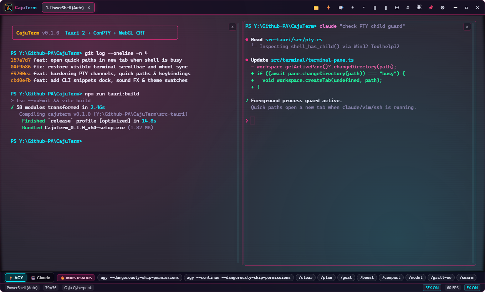
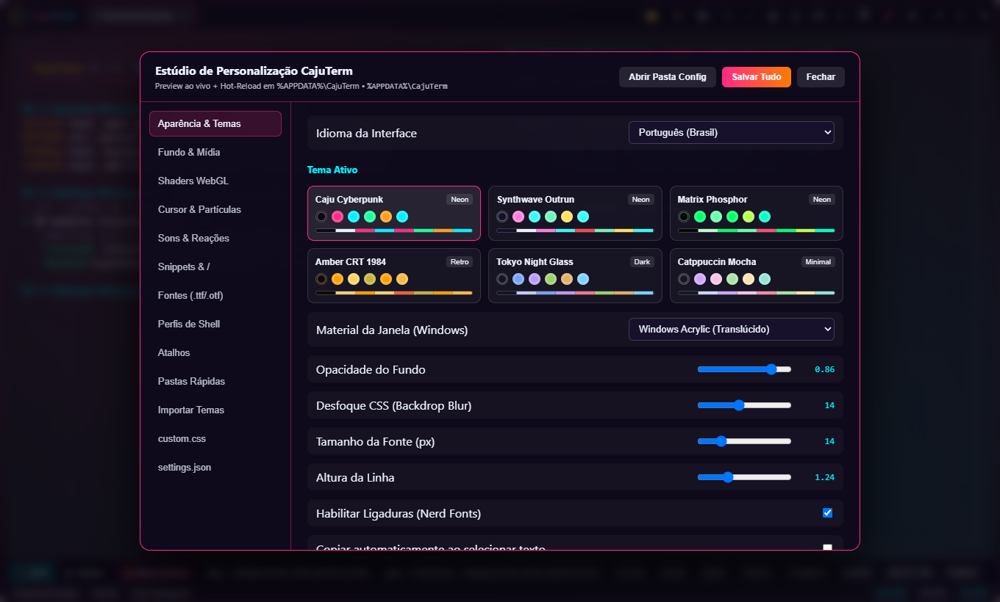
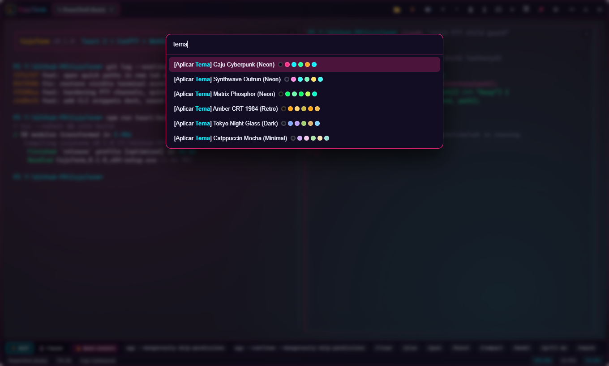

# CajuTerm

Um terminal para Windows que eu queria usar todo dia — rápido, bonito e do meu jeito.

O CajuTerm nasceu de uma vontade simples: ter o PowerShell, o CMD e o WSL num lugar só, com renderização por GPU, abas e splits, mas sem abrir mão de um visual com personalidade. Tem efeito de monitor CRT, cursor que brilha, sons discretos quando uma tarefa longa termina e um dock de comandos prontos para quem passa o dia com agentes de IA no terminal (Claude Code, AGY).

É feito com [Tauri 2](https://tauri.app), [xterm.js](https://xtermjs.org) e ConPTY — o instalador tem menos de 2 MB.



<details>
<summary>Mais capturas (Configurações e Paleta de Comandos)</summary>

| Estúdio de Personalização | Paleta de Comandos (`Ctrl+Shift+P`) |
|---|---|
|  |  |

</details>

---

## O que ele faz

**Terminal de verdade**
- PowerShell 7 (detectado automaticamente), Windows PowerShell 5.1, CMD e WSL, cada um como perfil.
- Renderização WebGL, ligaduras tipográficas, imagens inline (Sixel/iTerm) e Unicode 11.
- Abas e splits verticais/horizontais, com navegação por teclado entre painéis.
- Novos splits e abas abrem na pasta onde você já está (OSC 7 / OSC 9;9).
- Busca com destaque de todas as ocorrências e contador `3/17`, enquanto você digita.
- Pular entre prompts com `Ctrl+Shift+↑/↓` (em shells que emitem OSC 133).
- Zoom de fonte com `Ctrl+roda` ou `Ctrl+=` / `Ctrl+-` / `Ctrl+0`.
- Links abrem com `Ctrl+clique` — inclusive hyperlinks OSC 8.
- Aviso antes de colar várias linhas de uma vez.
- Copiar ao selecionar (opcional), copiar/colar com o botão direito.

**Visual**
- Seis temas de fábrica: Caju Cyberpunk, Synthwave Outrun, Matrix Phosphor, Amber CRT 1984, Tokyo Night Glass e Catppuccin Mocha.
- Importa esquemas de cor do Windows Terminal (cola o `settings.json`, com comentários e tudo).
- Shader CRT ajustável: scanlines, curvatura, bloom, aberração cromática, ruído e flicker.
- Fundo sólido, gradiente, imagem ou vídeo, com transparência Acrylic ou Mica.
- Efeitos no cursor (pulso, rastro, partículas) e reações quando uma tarefa termina ou dá erro.
- CSS customizado para quem quer ir além.
- Respeita a opção "reduzir movimento" do Windows.

**Pequenos confortos**
- Modo Quake: `` Ctrl+` `` traz o terminal de qualquer lugar.
- Sempre no topo, com um atalho.
- Sons curtos (Web Audio, nada de arquivos) quando uma saída longa termina, no bell ou em erro.
- Paleta de comandos (`Ctrl+Shift+P`) com busca que ignora acentos.
- Dock de snippets com os comandos que você mais usa, organizados por agente.
- Pastas rápidas para pular direto para seus projetos.
- Interface em português, inglês e espanhol.
- Abas que dá para arrastar, renomear com duplo clique e fechar com o botão do meio.

---

## Instalação

Baixe o instalador mais recente na página de [Releases](https://github.com/PedroArthurr/CajuTerm/releases):

- `CajuTerm_x.y.z_x64-setup.exe` — instalador NSIS (recomendado)
- `CajuTerm_x.y.z_x64_pt-BR.msi` — pacote MSI

Funciona no Windows 10 (1809+) e Windows 11. Precisa do WebView2, que já vem no Windows 11 e na maioria dos Windows 10 atualizados.

---

## Compilando do código

Você vai precisar de:

- [Node.js](https://nodejs.org) 18 ou mais novo
- [Rust](https://rustup.rs) (stable)
- Visual Studio Build Tools com a carga **"Desenvolvimento para desktop com C++"**

```bash
git clone https://github.com/PedroArthurr/CajuTerm.git
cd CajuTerm
npm install

npm run tauri:dev     # abre em modo desenvolvimento, com hot reload
npm run tauri:build   # gera o .exe e os instaladores em src-tauri/target/release/bundle
```

O script `tauri-runner` procura o `cargo` sozinho e avisa com instruções claras se faltar o Rust ou as ferramentas do MSVC.

---

## Atalhos

Todos podem ser trocados em **Configurações → Atalhos**. Eles funcionam pela tecla física, então se comportam igual em teclado ABNT2 ou US.

| Ação | Atalho |
|---|---|
| Nova aba | `Ctrl+Shift+T` |
| Fechar aba | `Ctrl+Shift+W` |
| Próxima / anterior | `Ctrl+Tab` / `Ctrl+Shift+Tab` |
| Split vertical | `Alt+Shift+D` |
| Split horizontal | `Alt+Shift+E` |
| Fechar painel | `Alt+Shift+W` |
| Mover foco entre painéis | `Alt+←↑↓→` |
| Buscar | `Ctrl+Shift+F` |
| Paleta de comandos | `Ctrl+Shift+P` |
| Configurações | `Ctrl+,` |
| Sempre no topo | `Ctrl+Shift+A` |
| Modo Quake (global) | `` Ctrl+` `` |
| Zoom da fonte | `Ctrl+=` / `Ctrl+-` / `Ctrl+0` |
| Prompt anterior / próximo | `Ctrl+Shift+↑` / `Ctrl+Shift+↓` |
| Quebra de linha sem enviar | `Shift+Enter` |

---

## Configuração

Tudo fica em `%APPDATA%\CajuTerm\`:

```
CajuTerm/
├── settings.json   # preferências, perfis, atalhos
├── custom.css      # seu CSS por cima do tema
├── themes/         # temas importados ou criados
└── fonts/          # fontes instaladas pelo app
```

Dá para editar à mão — o CajuTerm recarrega sozinho quando o arquivo muda. Se você salvar um JSON quebrado, ele continua com a última versão boa, guarda uma cópia do arquivo com erro e avisa, em vez de jogar suas configurações fora.

> As pastas rápidas padrão apontam para caminhos do meu computador. Troque em **Configurações → Pastas Rápidas**. Um caminho terminado em `/*` lista todas as subpastas dele.

---

## Por dentro

```
src/
├── terminal/   # painéis xterm.js, workspace (abas e splits), ponte com o PTY
├── fx/         # shader CRT, efeitos de cursor, sons
├── ui/         # configurações, paleta, modais
└── styles/
src-tauri/
└── src/        # ConPTY (portable-pty), comandos, configuração, janela
```

- A saída de cada terminal chega por um canal próprio do Tauri, em lotes de poucos milissegundos, com fila limitada — rodar `yes` não enche a memória.
- Escrever no shell acontece numa thread separada por sessão, então colar um texto enorme não trava a interface.
- Os efeitos param de desenhar quando não há nada animando, e o shader pausa quando a janela perde o foco.

---

## Estado do projeto

É um projeto pessoal, em evolução constante. Funciona bem no meu dia a dia, mas ainda tem arestas. Se algo quebrar, abra uma [issue](https://github.com/PedroArthurr/CajuTerm/issues) contando o que aconteceu — print ou GIF ajudam muito.

Pull requests são bem-vindos. Para mudanças maiores, abra uma issue antes para a gente conversar.

---

Feito com café e muito caju.
